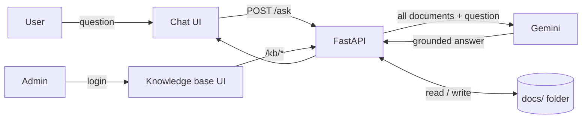

# Athena

A document Q&A assistant. Users ask questions in a chat interface, and Athena answers **only from your own documents**, quoting the passage and naming the source file. Admins manage the documents through a built-in knowledge base editor, and changes take effect immediately with no restart.

Built with FastAPI, Google Gemini and plain HTML/JS. No database, no vector store, no build step.

---

## Features

- **Grounded answers.** The model is instructed to answer only from the provided documents, quote its evidence, name the file, and say "I couldn't find this in the documents" otherwise.
- **Multi-format ingestion.** PDF, Word (`.docx`, including tables), Markdown and plain text, read from a nested folder structure.
- **Admin knowledge base.** Browse a folder tree, edit `.md`/`.txt` files, create folders, upload and delete files. Saves hot-reload the documents.
- **Admin-only access.** The knowledge base and its API sit behind HTTP Basic auth with constant-time credential comparison. The chat stays public.
- **Polished chat UI.** Responsive, light/dark aware, keyboard friendly, with loading states, error recovery with retry, and copy-to-clipboard.
- **Zero infrastructure.** One Python process and a folder of files.

## How it works



On startup, `main.py` walks `docs/`, extracts the text from each supported file, and holds it in memory wrapped in `<document name="...">` tags. Each question sends that full corpus plus the question to Gemini with a strict system prompt. Admin edits rewrite the file on disk and rebuild the in-memory corpus.

## Project structure

```
athena/
├── main.py              # FastAPI app: readers, loader, chat API, admin API
├── requirements.txt
├── .env                 # secrets (never commit)
├── .gitignore
├── static/
│   ├── index.html       # chat UI
│   └── knowledge.html   # admin knowledge base UI
└── docs/                # your knowledge base (nested folders allowed)
    ├── architecture/
    ├── operations/
    └── api/
```

## Quick start

**Requirements:** Python 3.10+ and a free Gemini API key from [aistudio.google.com/apikey](https://aistudio.google.com/apikey).

```bash
# 1. Get the code
git clone https://github.com/kalibbalajohnson/Athena.git
cd athena

# 2. Create and activate a virtual environment
python3 -m venv venv
source venv/bin/activate          # Windows: venv\Scripts\activate

# 3. Install dependencies
pip install -r requirements.txt

# 4. Configure secrets
cat > .env << 'EOF'
GEMINI_API_KEY=your-gemini-key
ADMIN_USER=admin
ADMIN_PASSWORD=choose-a-long-password
EOF

# 5. Add documents (PDF, DOCX, MD, TXT) to docs/

# 6. Run
uvicorn main:app --reload
```

Open **http://localhost:8000** for the chat, and **http://localhost:8000/knowledge** for the admin area.

The terminal prints one `Loaded <file> (N characters)` line per document at startup. If a file is missing from that list, the assistant cannot answer from it.

## Configuration

| Variable | Required | Default | Purpose |
|---|---|---|---|
| `GEMINI_API_KEY` | Yes | none | Google Gemini API key |
| `ADMIN_USER` | No | `admin` | Admin username |
| `ADMIN_PASSWORD` | For admin access | none | Admin password. If unset, admin routes return 503 (fail closed) |

The model is set by the `MODEL` constant at the top of `main.py`. Model IDs change over time, so copy a current Flash model ID from Google AI Studio if you get a 404.

## Using it

**Chat.** Ask a question and press Enter. Answers name their source document.

**Knowledge base (admin).**

| Action | How |
|---|---|
| Browse and search | Folder tree on the left, filter box above it |
| Edit | Click a `.md` or `.txt` file, edit, press **Save** or `Ctrl+S` |
| Create | **File** and **Folder** buttons create inside the selected folder |
| Upload | **Upload** accepts `.pdf`, `.docx`, `.md`, `.txt` |
| Delete | Trash icon on hover, or the delete button in the editor |

PDF and Word files open as a read-only preview of the extracted text. To change them, upload a new version.

## API reference

| Method | Path | Auth | Description |
|---|---|---|---|
| `GET` | `/` | Public | Chat UI |
| `POST` | `/ask` | Public | Body `{"question": "..."}`, returns `{"answer": "..."}` |
| `GET` | `/knowledge` | Admin | Knowledge base UI |
| `GET` | `/kb/tree` | Admin | Nested file tree |
| `GET` | `/kb/file?path=` | Admin | File content (extracted text for PDF/DOCX) |
| `PUT` | `/kb/file` | Admin | Save `.md`/`.txt`, body `{"path", "content"}` |
| `POST` | `/kb/folder` | Admin | Create folder, body `{"path"}` |
| `POST` | `/kb/upload?folder=` | Admin | Multipart file upload |
| `DELETE` | `/kb/item?path=` | Admin | Delete a file or folder |

Interactive docs are available at `/docs` (FastAPI's built-in Swagger UI).

## Design decisions

**Full-context prompting instead of RAG.** The whole corpus goes into every request. For a small to medium knowledge base this is simpler and more accurate than chunking, embeddings and a vector database, because the model sees complete documents and there is no retrieval step that can miss the right passage. The trade-off is cost and latency growing with corpus size (see Limitations).

**Prompt-level grounding.** A strict system prompt requires quoting the supporting passage and naming the document, which makes every answer verifiable, and defines an explicit "not found" response to reduce fabricated answers.

**Files as the source of truth.** No database. The `docs/` folder is the knowledge base, which keeps it diffable, backup-friendly and easy to inspect.

**Separated readers.** Each format has its own reader function registered in a `READERS` dict keyed by extension. Adding a format is one function and one line.

**Defensive file handling.** All admin paths are resolved and checked to stay inside `docs/` (no path traversal), uploads are restricted to supported extensions, and only text formats are writable.

## Security notes

- Admin credentials are compared with `secrets.compare_digest`. Admin routes fail closed when no password is configured.
- HTTP Basic auth sends credentials on every request, so **serve it over HTTPS in any non-local environment**.
- Everything in `docs/` can surface through chat answers. Only include content you are comfortable exposing to anyone who can reach the chat.
- Keep `.env` out of version control. In production, use your platform's secret manager.
- The free Gemini tier may use inputs to improve Google products. For private documents, use a paid tier.
- `/ask` has no rate limiting. Anyone with the URL can spend your API quota, so set a spend limit in your provider console and add rate limiting before a public launch.

## Limitations

- **Corpus size.** Works for roughly a few hundred pages in total. Beyond that, add retrieval (chunking, embeddings, a vector store) to send only relevant passages.
- **Stateless chat.** Each question is answered independently, so follow-ups like "and for staging?" lack context.
- **Scanned PDFs.** Image-only PDFs have no extractable text and are skipped with a warning. They need OCR first.
- **Single instance.** The corpus is cached in process memory. Running several instances requires shared storage and a reload mechanism.
- **Basic auth.** Adequate for a demo or internal tool. For a product, replace it with sessions or SSO.

## Deployment notes

- Files are written to the local `docs/` folder. On ephemeral platforms (most container and PaaS hosts) the disk resets on redeploy, so admin edits would be lost. Use a persistent disk, or move storage to object storage such as S3.
- Start command: `uvicorn main:app --host 0.0.0.0 --port $PORT`
- Terminate TLS in front of the app (reverse proxy or load balancer).

## Sample data and testing

The repo's sample knowledge base describes a fictional order platform called Orbit (architecture, auth, data layer, deployment, incident response, monitoring, API reference). To evaluate quality, ask:

| Type | Question | Expected |
|---|---|---|
| Direct lookup | How long does an access token last? | 15 minutes |
| Rule check | Can I deploy on Friday at 15:00 UTC? | No, freeze after 14:00 UTC on Fridays |
| Table data | When does a high error rate alert page on-call? | More than 2% 5xx for 5 minutes |
| Cross-document | Which language is the service that stores sessions in Redis written in? | Go |
| Outdated info | Which message broker does Orbit use? | Kafka (RabbitMQ was removed) |
| Out of scope | Which Kubernetes version do you run? | "I couldn't find this in the documents." |

A healthy system answers the first five correctly with a quoted source and refuses the last. Fabricating an answer to an out-of-scope question means the system prompt needs tightening.

## Troubleshooting

| Symptom | Cause and fix |
|---|---|
| Chat shows an error with a red message | Read the message and the `uvicorn` terminal output. Usual causes: invalid key, wrong `MODEL` ID (404), or quota exceeded (429). |
| `KeyError: 'GEMINI_API_KEY'` | `.env` is missing or not in the project root |
| Answers say "couldn't find" for everything | `docs/` is empty, or files are scanned PDFs with no text. Check the `Loaded ...` lines at startup. |
| Admin page returns 503 | `ADMIN_PASSWORD` is not set in `.env` |
| Upload fails | Install `python-multipart` (`pip install -r requirements.txt`) and use a supported file type |
| `pip` blocked on Ubuntu (`externally-managed-environment`) | Use the virtual environment from step 2 |

## Roadmap

- Retrieval layer (chunking and embeddings) for large corpora
- Conversation memory for follow-up questions
- Session-based admin auth with roles
- S3-backed storage and multi-instance cache invalidation
- Automated evaluation suite for answer accuracy

## Requirements file

```
fastapi
uvicorn
google-genai
pypdf
python-docx
python-dotenv
python-multipart
```
